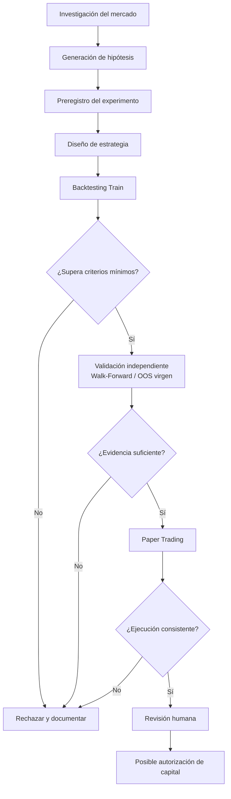

# PROTOCOLO DE INVESTIGACIÓN Y DESCUBRIMIENTO DE ESTRATEGIAS RENTABLES

**Identificador:** QRP-001
**Versión:** 1.0
**Estado:** Sustituido por v1.1 (`PROTOCOLO_INVESTIGACION_ESTRATEGIAS_v1.1.md`). Se conserva como registro histórico.
**Tipo:** Documento rector de investigación cuantitativa
**Responsable:** Revisión humana
**Ejecutor:** Agente de IA local
**Proyecto:** Bot de Trading

---

## 1. OBJETIVO

Desarrollar un proceso sistemático, reproducible y auditable para descubrir, evaluar y validar estrategias de trading que puedan presentar una ventaja estadística sostenible después de costos operativos.

El agente tendrá la responsabilidad de investigar oportunidades, formular hipótesis, diseñar experimentos, ejecutar backtests, evaluar resultados y descartar estrategias que no demuestren evidencia suficiente.

El objetivo no es encontrar una estrategia que produzca beneficios dentro de un backtest, sino identificar una ventaja estadística que pueda sobrevivir a condiciones reales de mercado.

No existe obligación de encontrar una estrategia aprobada. La ausencia de resultados positivos es un resultado válido de investigación.

## 2. CONTEXTO Y ANTECEDENTES

La Fase 0 concluyó como NO APROBADA.

La hipótesis anterior (Mean Reversion H1 BTC/USDT) evaluó las configuraciones A, B, E1 y E2.

Resultados:

- Expectancy neta negativa en todas las configuraciones (también negativa antes de costos).
- Profit Factor inferior a 1.0.
- Reproducción independiente confirmada.
- Operaciones, métricas e intervalos de confianza reproducidos.
- Cierre documentado en el commit `25f0e3f` (`backtest/REPORTE_FASE0.md`).

La hipótesis anterior queda cerrada permanentemente.

No se permite:

- Reabrirla para intentar mejorar retrospectivamente sus resultados.
- Modificar sus resultados históricos.
- Reutilizar sus resultados como evidencia favorable de una hipótesis nueva.
- Ajustar parámetros para conseguir artificialmente una aprobación.

Los experimentos nuevos deberán tener identificadores, preregistros y resultados independientes.

### Ciclo de investigación

El agente no debe saltarse etapas porque una estrategia presente resultados atractivos.

## 3. UNIVERSO DE INVESTIGACIÓN

Investigar sistemáticamente las siguientes familias. Son líneas de investigación, no recomendaciones de operación; no se asume que alguna funcione.

### 3.1 Trend Following

Identificar movimientos direccionales persistentes.

Investigar:

- Medias móviles.
- Momentum tendencial.
- Confirmación de tendencia.
- Rupturas con continuación.
- Filtros de volatilidad.

### 3.2 Mean Reversion

Investigar posibles reversiones después de movimientos extremos.

Investigar:

- Desviaciones estadísticas.
- Bandas de volatilidad.
- Sobreextensión de precios.
- Reversiones intradía.
- Condiciones de agotamiento.

### 3.3 Momentum

Evaluar persistencia del rendimiento y aceleración de movimientos.

Investigar:

- Momentum de diferentes horizontes.
- Fuerza relativa.
- Momentum ajustado por volatilidad.
- Confirmaciones entre temporalidades.

### 3.4 Breakout

Investigar rupturas de rangos y niveles relevantes.

Investigar:

- Rangos de consolidación.
- Volatilidad comprimida.
- Rupturas confirmadas.
- Falsas rupturas.
- Volumen y expansión de volatilidad.

### 3.5 Market Regime

Investigar si distintas condiciones del mercado requieren estrategias diferentes.

Identificar:

- Tendencia alcista.
- Tendencia bajista.
- Mercado lateral.
- Alta volatilidad.
- Baja volatilidad.
- Transiciones entre regímenes.

No asumir que una estrategia funciona en todos los regímenes.

### 3.6 Otras hipótesis

El agente puede proponer familias adicionales si identifica una justificación cuantitativa o microestructural.

Cada familia nueva deberá incluir:

- Fundamento económico o estadístico.
- Mecanismo esperado de generación de beneficios.
- Datos necesarios.
- Riesgos metodológicos.
- Hipótesis falsable.

## 4. INVESTIGACIÓN Y GENERACIÓN DE HIPÓTESIS

Antes de programar una estrategia, el agente deberá investigar su fundamento.

Para cada hipótesis deberá documentar:

1. Fenómeno de mercado que pretende explotar.
2. Razón por la que podría persistir.
3. Condiciones necesarias para funcionar.
4. Condiciones en las que probablemente falle.
5. Evidencia previa disponible.
6. Posibles explicaciones alternativas.
7. Riesgos de sobreajuste.
8. Datos necesarios para comprobarla.

El agente debe distinguir entre:

- Evidencia empírica.
- Literatura académica.
- Hipótesis propia.
- Suposiciones no verificadas.

No presentar una estrategia como rentable únicamente porque utiliza indicadores conocidos o porque otros operadores reportan beneficios.

## 5. PREREGISTRO OBLIGATORIO

Ningún experimento podrá comenzar sin un archivo de preregistro.

Ubicación: `backtest/experiments/EXP-XXXX/preregistration.md`

El preregistro deberá incluir:

- Identificador del experimento.
- Fecha de creación.
- Hipótesis.
- Mercado y par de negociación.
- Temporalidades.
- Periodo de datos.
- Variables utilizadas.
- Reglas de entrada.
- Reglas de salida.
- Gestión de riesgo.
- Costos estimados.
- Parámetros y rangos permitidos.
- Número máximo de configuraciones.
- Métricas de evaluación.
- Criterios de rechazo.
- Criterios de aprobación.
- Plan de validación independiente.

Una vez iniciado el experimento, los cambios sustanciales deberán generar una nueva versión del preregistro o un nuevo experimento.

## 6. POLÍTICA DE DATOS

Toda investigación deberá identificar la procedencia, integridad y exposición previa de los datos.

Requisitos:

- Registrar SHA-256 de cada dataset.
- Registrar zona horaria y frecuencia.
- Validar duplicados, gaps y valores OHLC.
- Registrar fuente de descarga.
- Conservar versiones originales.
- Registrar transformaciones.
- Evitar información futura en cualquier cálculo.
- Utilizar únicamente información disponible en el momento de cada decisión.

### Protección OOS

El periodo OOS debe permanecer aislado.

El agente no podrá:

- Consultar sus resultados para modificar estrategias.
- Ajustar parámetros utilizando OOS.
- Seleccionar hipótesis según su desempeño OOS.
- Utilizar datos contaminados como validación independiente.

Existe una exposición histórica documentada en el intervalo aproximado del 31 de octubre al 8 de noviembre de 2025 (usado como Train en la primera ejecución de Fase 0).

Este intervalo no deberá declararse OOS virgen.

La validación definitiva de nuevas hipótesis deberá utilizar un periodo posterior al preregistro y al congelamiento de la estrategia, sin exposición previa a sus resultados.

Cuando sea necesario, se utilizará validación prospectiva.

## 7. DISEÑO EXPERIMENTAL

Cada estrategia deberá contar con una implementación independiente.

Se deberán separar:

- Generación de señales.
- Ejecución simulada.
- Gestión de posiciones.
- Gestión de capital.
- Modelo de costos.
- Registro de operaciones.
- Evaluación estadística.

El backtest deberá contemplar:

- Comisiones de entrada y salida.
- Spread.
- Slippage.
- Latencia cuando sea relevante.
- Liquidez disponible.
- Restricciones del exchange.
- Tamaño mínimo de órdenes.
- Precisión de cantidades.
- Redondeos.
- Deslizamiento por ejecución parcial cuando corresponda.

No se aceptarán resultados basados exclusivamente en precios ideales de cierre de velas cuando la ejecución real no pueda producirse a esos precios.

## 8. MÉTRICAS OBLIGATORIAS

Cada experimento deberá presentar:

### Rentabilidad

- PnL bruto.
- PnL neto.
- Retorno porcentual.
- Expectancy por operación.
- Profit Factor.
- Ganancia media.
- Pérdida media.

### Riesgo

- Maximum Drawdown.
- Drawdown duration.
- Sharpe Ratio.
- Sortino Ratio.
- Calmar Ratio.
- Exposición al mercado.

### Calidad estadística

- Número de operaciones.
- Porcentaje de operaciones ganadoras.
- Intervalos de confianza del 95%.
- Distribución de rendimientos.
- Dependencia entre operaciones.
- Estabilidad de la expectativa.
- Sensibilidad a parámetros.

### Costos

- Comisiones totales.
- Spread estimado.
- Slippage.
- Costos operativos acumulados.
- Rentabilidad neta después de costos.

Ninguna métrica deberá utilizarse de forma aislada para aprobar una estrategia.

## 9. CONTROL DE SOBREAJUSTE

El agente deberá proteger la investigación contra:

- Overfitting.
- Data snooping.
- Look-ahead bias.
- Survivorship bias cuando corresponda.
- Selección retrospectiva de periodos.
- Optimización excesiva de parámetros.
- Leakage entre Train y validación.
- Múltiples pruebas no contabilizadas.

Se deberá conservar un registro de todos los experimentos, incluidos los rechazados.

Cuando el volumen de pruebas lo permita, aplicar:

- Walk-Forward Analysis.
- Purged Cross-Validation.
- Embargo temporal.
- Probability of Backtest Overfitting.
- Deflated Sharpe Ratio.
- Bootstrap por bloques cuando sea apropiado.

El agente deberá justificar qué métodos son estadísticamente adecuados para cada experimento.

## 10. CRITERIOS DE EVALUACIÓN

Una estrategia será descartada si:

- Presenta expectancy neta negativa.
- Su rentabilidad depende de costos irreales.
- Presenta resultados inconsistentes.
- Su comportamiento depende de una configuración extremadamente específica.
- No dispone de suficientes observaciones.
- Presenta evidencia de leakage.
- Su rendimiento desaparece bajo variaciones razonables de ejecución.

Una estrategia con resultados positivos en Train no será considerada validada.

Los umbrales numéricos de aprobación deberán establecerse en el preregistro de cada experimento y justificarse antes de observar los resultados de validación.

No se permitirá cambiar los umbrales después de conocer los resultados para conseguir una aprobación.

## 11. REGISTRO DE EXPERIMENTOS

Estructura: `backtest/experiments/`

Cada experimento deberá mantener:

- `preregistration.md`
- `hypothesis.md`
- `strategy.py`
- `config.yaml`
- `data_manifest.json`
- `execution_model.md`
- `results.json`
- `metrics.csv`
- `trades.csv`
- `validation.md`
- `REPORT.md`

El contenido dependerá de la naturaleza del experimento, pero los archivos esenciales deberán estar presentes.

Los experimentos cerrados serán inmutables.

Los resultados deberán poder reproducirse mediante una instrucción documentada.

## 12. AUTONOMÍA DEL AGENTE

El agente tendrá autonomía para:

- Investigar.
- Proponer hipótesis.
- Diseñar estrategias experimentales.
- Escribir código de investigación.
- Ejecutar backtests.
- Analizar resultados.
- Identificar errores.
- Descartar experimentos.
- Proponer nuevas investigaciones.
- Generar reportes.

El agente no tendrá autorización para:

- Ejecutar órdenes reales.
- Utilizar capital real.
- Modificar credenciales.
- Realizar retiros.
- Modificar parámetros de producción.
- Alterar experimentos cerrados.
- Modificar el dataset original.
- Aprobar por sí mismo una estrategia para producción.

Las modificaciones al código de producción y las autorizaciones financieras requieren aprobación humana.

## 13. PROGRESIÓN DE VALIDACIÓN

Una estrategia deberá superar las siguientes etapas:

- **Etapa A — Investigación.** Fundamento y formulación de hipótesis.
- **Etapa B — Preregistro.** Definición de reglas y criterios.
- **Etapa C — Backtesting.** Evaluación sobre Train.
- **Etapa D — Validación robusta.** Walk-Forward, sensibilidad y controles estadísticos.
- **Etapa E — Validación prospectiva.** Evaluación sobre datos no utilizados para desarrollar o seleccionar la estrategia.
- **Etapa F — Paper Trading.** Simulación con condiciones de ejecución reales, sin capital financiero.
- **Etapa G — Revisión humana.** Auditoría metodológica, operativa y financiera.
- **Etapa H — Autorización de producción.** Decisión humana independiente.

Ninguna etapa implica aprobación automática de la siguiente.

## 14. REPORTE EJECUTIVO

Al finalizar cada experimento, el agente deberá entregar:

1. Hipótesis evaluada.
2. Justificación de la investigación.
3. Datos utilizados.
4. Metodología.
5. Configuraciones probadas.
6. Número total de pruebas.
7. Resultados brutos y netos.
8. Métricas de riesgo.
9. Evidencia estadística.
10. Análisis de robustez.
11. Limitaciones.
12. Comparación contra benchmarks.
13. Dictamen.
14. Recomendación de investigación posterior.

El dictamen deberá ser uno de los siguientes:

- RECHAZADO.
- INCONCLUSO.
- CANDIDATO A VALIDACIÓN.
- VALIDADO EXPERIMENTALMENTE.
- PENDIENTE DE REVISIÓN HUMANA.

Nunca utilizar el término RENTABLE como conclusión definitiva basándose únicamente en un backtest histórico.

## 15. PRINCIPIO RECTOR

La prioridad no es producir operaciones, maximizar el número de estrategias ni conseguir resultados visualmente atractivos.

La prioridad es descubrir una ventaja estadística real, reproducible y suficientemente robusta para justificar una investigación de ejecución.

Un experimento negativo es información útil.

Una estrategia descartada correctamente representa progreso.

Una estrategia aprobada sin evidencia suficiente representa un fallo del proceso.

**La evidencia determina las decisiones, no las expectativas del investigador.**

---

## Anexo — Puntos abiertos antes de la aprobación

*Añadido por el agente ejecutor durante la redacción. No forma parte del protocolo hasta que la revisión humana lo resuelva.*

1. **Presupuesto global de pruebas.** §9 prohíbe las "múltiples pruebas no contabilizadas", pero solo limita las configuraciones dentro de cada experimento. Con cinco familias, el número total de pruebas crece sin tope, y es justamente lo que infla la probabilidad de un falso positivo. El Deflated Sharpe Ratio y el PBO necesitan además un conteo total de pruebas para calcularse. Propuesta: fijar un presupuesto global (por ejemplo, N experimentos y M configuraciones en total) y llevar un contador acumulado en `REGISTRO_EXPERIMENTOS.md`.

2. **Umbrales mínimos comunes.** §10 deja los umbrales en manos de cada preregistro. Sin un piso común, un experimento podría preregistrar criterios laxos. Propuesta: que `CRITERIOS_APROBACION.md` fije mínimos no negociables (por ejemplo, los de Fase 0: expectancy > 0, PF > 1.2, DD < 10%, IC 95% por encima de 0), que cada preregistro solo pueda endurecer.

3. **Uso del segmento 2025-11-08 → 2026-10-31.** Es el único tramo histórico sobre el que nunca se tomó una decisión. §6 exige que la validación definitiva sea posterior al preregistro, lo que en la práctica obliga a esperar meses de datos prospectivos. Hay que decidir si ese tramo puede servir como holdout histórico de un solo uso, compartido por todos los experimentos (y por tanto gastado la primera vez que se consulte), o si se descarta como validación y todo pasa a prospectivo.

4. **Datos ya vistos.** Los datos de 2023-05 → 2025-10 se usaron en Fase 0, y cualquier hipótesis nueva se formula conociendo cómo se comportó el precio en ese periodo. No hace falta prohibirlo, pero conviene que cada preregistro declare qué datos ya vio el investigador.

5. **Auditoría independiente.** La separación investigador/auditor que se propone para `ARQUITECTURA_QUANT_AGENT_v1.0.md` reduce el riesgo, pero si ambos componentes son el mismo modelo comparten sesgos. La revisión humana de la Etapa G sigue siendo el control independiente real.

6. **Alcance del modelo de ejecución.** §7 pide modelar latencia, liquidez y ejecución parcial. Para estrategias H1 o superiores en BTC/USDT spot con capital pequeño, varios de esos factores son despreciables. Propuesta: que `execution_model.md` justifique qué se modela y qué se omite en cada experimento, en lugar de exigirlo todo siempre.

7. **Mercado.** El documento de origen menciona BTC/MXN y BTC/USDT. Fase 0 descartó Bitso por costos. Conviene fijar si el universo inicial es solo BTC/USDT en Binance spot.
