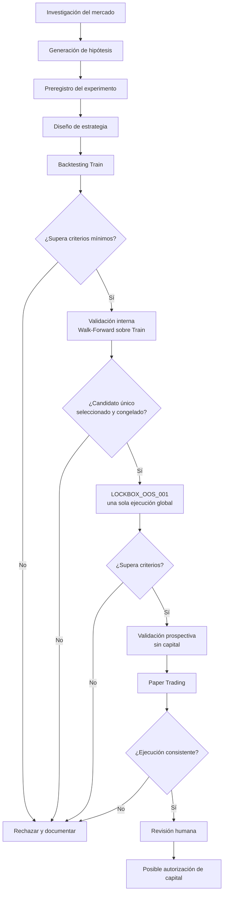

# PROTOCOLO DE INVESTIGACIÓN Y DESCUBRIMIENTO DE ESTRATEGIAS RENTABLES

**Identificador:** QRP-001
**Versión:** 1.1
**Estado:** **APROBADO INTEGRALMENTE** (2026-11-08). Investigación habilitada sobre Train una vez completados A-2 y A-3 (`ARQUITECTURA_QUANT_AGENT_v1.0.md` §10). Lockbox bloqueado hasta completar A-4 y obtener autorización humana.
**Sustituye a:** v1.0 (`PROTOCOLO_INVESTIGACION_ESTRATEGIAS_v1.0.md`, conservada como histórico)
**Tipo:** Documento rector de investigación cuantitativa
**Responsable:** Revisión humana
**Ejecutor:** Agente de IA local
**Proyecto:** Bot de Trading

**Documentos complementarios** (en `backtest/docs/`):

| Documento | Responsabilidad |
|---|---|
| `REGISTRO_DECISIONES.md` | Decisiones aprobadas y pendientes |
| `POLITICA_DATOS_OOS.md` | Integridad de datos y aislamiento de LOCKBOX_OOS_001 |
| `CRITERIOS_APROBACION.md` | Umbrales y puertas de validación (borrador) |
| `REGISTRO_HIPOTESIS.md` | Historial de hipótesis |
| `REGISTRO_EXPERIMENTOS.md` | Experimentos, dictámenes y contador global de pruebas |
| `ARQUITECTURA_QUANT_AGENT_v1.0.md` | Roles, accesos y controles técnicos del lockbox |
| `INCIDENCIAS.md` | Incidencias de trazabilidad |
| `EVIDENCIA_AISLAMIENTO_LOCKBOX.md` | Pruebas de las capas de aislamiento |
| `FUNDAMENTO_HORIZONTE_SWING.md` | Por qué se descartó scalping (1.0.0) y se adoptó Swing (D-025) |

### Cambios respecto a v1.0

- §3 nuevo: universo operativo cerrado (Binance Spot, BTC/USDT, Swing, Long Only).
- §4: las familias de estrategia se acotan a ese universo.
- §5: horizonte, temporalidades y permanencia.
- §8: máquina de estados FLAT → LONG → FLAT.
- §9: modelo de ejecución Binance Spot.
- §11: benchmarks.
- §7: la política OOS se sustituye por LOCKBOX_OOS_001 (detalle en `POLITICA_DATOS_OOS.md`).
- §16: validación prospectiva.
- El anexo de puntos abiertos de v1.0 se traslada a `REGISTRO_DECISIONES.md`.

---

## 1. OBJETIVO

Desarrollar un proceso sistemático, reproducible y auditable para descubrir, evaluar y validar estrategias de trading que puedan presentar una ventaja estadística sostenible después de costos operativos.

El agente tendrá la responsabilidad de investigar oportunidades, formular hipótesis, diseñar experimentos, ejecutar backtests, evaluar resultados y descartar estrategias que no demuestren evidencia suficiente.

El objetivo no es encontrar una estrategia que produzca beneficios dentro de un backtest, sino identificar una ventaja estadística que pueda sobrevivir a condiciones reales de mercado y que aporte valor frente a simplemente mantener BTC o USDT.

No existe obligación de encontrar una estrategia aprobada. La ausencia de resultados positivos es un resultado válido de investigación.

## 2. CONTEXTO Y ANTECEDENTES

La Fase 0 concluyó como NO APROBADA.

La hipótesis anterior (Mean Reversion H1 BTC/USDT) evaluó las configuraciones A, B, E1 y E2.

Resultados:

- Expectancy neta negativa en todas las configuraciones (también negativa antes de costos).
- Profit Factor inferior a 1.0.
- Reproducción independiente confirmada.
- Operaciones, métricas e intervalos de confianza reproducidos.
- Cierre documentado en el commit `25f0e3f` (`backtest/REPORTE_FASE0.md`).

La hipótesis anterior queda cerrada permanentemente.

No se permite:

- Reabrirla para intentar mejorar retrospectivamente sus resultados.
- Modificar sus resultados históricos.
- Reutilizar sus resultados como evidencia favorable de una hipótesis nueva.
- Ajustar parámetros para conseguir artificialmente una aprobación.

Los experimentos nuevos deberán tener identificadores, preregistros y resultados independientes. Las 4 configuraciones de Fase 0 cuentan en el registro histórico de pruebas (ver `REGISTRO_EXPERIMENTOS.md`).

### Ciclo de investigación



El agente no debe saltarse etapas porque una estrategia presente resultados atractivos.

## 3. UNIVERSO OPERATIVO (decisión aprobada)

El universo de investigación queda restringido a:

| Elemento | Decisión |
|---|---|
| Exchange | Binance |
| Mercado | Spot |
| Instrumento | BTC/USDT |
| Activo negociado | BTC |
| Activo de cotización | USDT |
| Dirección | Long Only |
| Horizonte | Swing Trading (horas a días) |
| Apalancamiento | No permitido |
| Margen y préstamos | No permitidos |
| Derivados | Fuera del alcance |
| Posiciones cortas | No permitidas |

El agente busca oportunidades para mantener BTC mediante posiciones Spot y cerrarlas a USDT. No busca rentabilidad mediante posiciones cortas, futuros ni apalancamiento.

Cualquier ampliación a otros pares, exchanges, derivados, direcciones o temporalidades fuera de §5 requiere aprobación humana y un experimento independiente. El agente no puede ampliar el universo por iniciativa propia; debe presentarlo como solicitud de aprobación independiente.

## 4. FAMILIAS DE INVESTIGACIÓN

Dentro del universo de §3, investigar las siguientes familias. Son líneas de investigación, no recomendaciones de operación; no se asume que alguna funcione. Todas generan únicamente señales de entrada en largo y de salida a USDT.

### 4.1 Trend Following

Mantenerse en largo durante movimientos alcistas persistentes y salir a USDT cuando la tendencia se debilita.

- Medias móviles.
- Momentum tendencial.
- Confirmación de tendencia.
- Rupturas con continuación.
- Filtros de volatilidad.

### 4.2 Mean Reversion

Comprar tras caídas extremas que tienden a revertir.

- Desviaciones estadísticas.
- Bandas de volatilidad.
- Sobreextensión de precios.
- Condiciones de agotamiento.

La variante Mean Reversion H1 con RSI(14) y filtro EMA200 H4 está cerrada (Fase 0). Una hipótesis nueva de esta familia debe diferir en su mecanismo, no solo en parámetros, y declararlo en su preregistro.

### 4.3 Momentum

Comprar cuando la fuerza compradora persiste.

- Momentum de diferentes horizontes.
- Momentum ajustado por volatilidad.
- Confirmaciones entre temporalidades.

### 4.4 Breakout

Comprar rupturas alcistas de rangos y niveles relevantes.

- Rangos de consolidación.
- Volatilidad comprimida.
- Rupturas confirmadas y falsas rupturas.
- Volumen y expansión de volatilidad.

### 4.5 Market Regime

Decidir cuándo estar expuesto y cuándo permanecer en USDT según el régimen.

- Tendencia alcista, bajista y lateral.
- Alta y baja volatilidad.
- Transiciones entre regímenes.

En Long Only, un régimen bajista no se opera en corto: se traduce en permanecer FLAT. No asumir que una estrategia funciona en todos los regímenes.

### 4.6 Otras hipótesis

El agente puede proponer familias adicionales compatibles con §3 si identifica una justificación cuantitativa o microestructural. Cada una deberá incluir:

- Fundamento económico o estadístico.
- Mecanismo esperado de generación de beneficios.
- Datos necesarios.
- Riesgos metodológicos.
- Hipótesis falsable.

## 5. HORIZONTE Y TEMPORALIDADES

El horizonte es Swing Trading: posiciones abiertas durante horas o días. No se impone una temporalidad única antes de investigar. El fundamento de este horizonte —y el cierre del planteamiento de convertir el bot 1.0.0 en scalping— está en `FUNDAMENTO_HORIZONTE_SWING.md` (D-025). Scalping queda fuera del universo: incompatible con el modo de trabajo del operador y con `MAX_TRADES_MONTH = 8` (D-014).

| Temporalidad | Función potencial |
|---|---|
| 1H | Identificación de señales y entradas |
| 4H | Confirmación de tendencia y estructura |
| 1D | Contexto de mercado y régimen |

Esto no autoriza a probar todas las combinaciones indiscriminadamente. Cada preregistro deberá justificar qué temporalidades necesita y su función, y fijar:

- Temporalidad de señal.
- Temporalidad de confirmación, si existe.
- Tiempo mínimo de permanencia, si aplica.
- Tiempo máximo de permanencia.
- Condiciones de entrada y salida.
- Frecuencia operativa esperada y máxima.
- Exposición máxima al capital.
- Tratamiento de posiciones abiertas al finalizar el periodo de evaluación.

No se permite seleccionar temporalidades retrospectivamente según su rentabilidad sin contabilizar esas pruebas en el registro global.

Las velas de temporalidades superiores se construyen a partir de datos H1 con límites UTC, y solo se usan velas cerradas.

## 6. INVESTIGACIÓN Y GENERACIÓN DE HIPÓTESIS

Antes de programar una estrategia, el agente deberá investigar su fundamento. Para cada hipótesis deberá documentar en `REGISTRO_HIPOTESIS.md` y en el `hypothesis.md` del experimento:

1. Fenómeno de mercado que pretende explotar.
2. Razón por la que podría persistir.
3. Condiciones necesarias para funcionar.
4. Condiciones en las que probablemente falle.
5. Evidencia previa disponible.
6. Posibles explicaciones alternativas.
7. Riesgos de sobreajuste.
8. Datos necesarios para comprobarla.
9. Datos que el investigador ya vio o conoce, incluido el conocimiento general del comportamiento del precio (ver `POLITICA_DATOS_OOS.md` §4).

El agente debe distinguir entre:

- Evidencia empírica.
- Literatura académica.
- Hipótesis propia.
- Suposiciones no verificadas.

No presentar una estrategia como rentable únicamente porque utiliza indicadores conocidos o porque otros operadores reportan beneficios.

## 7. PREREGISTRO OBLIGATORIO

Ningún experimento podrá comenzar sin un archivo de preregistro.

Ubicación: `backtest/experiments/EXP-XXXX/preregistration.md`

El preregistro deberá incluir:

- Identificador del experimento.
- Fecha de creación.
- Hipótesis.
- Mercado y par (BTC/USDT Spot, salvo aprobación de §3).
- Temporalidades y su función (§5).
- Permanencia mínima y máxima (§5).
- Periodo de datos, con límites UTC exactos.
- Variables utilizadas.
- Reglas de entrada y salida.
- Gestión de riesgo y exposición máxima.
- Modelo de ejecución y costos, base y adverso (§9).
- Parámetros y rangos permitidos.
- Número máximo de configuraciones.
- Métricas de evaluación.
- Benchmarks (§11).
- Criterios de rechazo.
- Criterios de aprobación (no inferiores a los mínimos de `CRITERIOS_APROBACION.md`).
- Plan de validación interna.
- Declaración de datos vistos.

Una vez iniciado el experimento, los cambios sustanciales deberán generar una nueva versión del preregistro o un nuevo experimento.

## 8. MÁQUINA DE ESTADOS LONG ONLY

El motor de simulación contempla únicamente:

```
FLAT ──(compra ejecutable)──▶ LONG ──(venta ejecutable)──▶ FLAT
```

| Estado | Significado |
|---|---|
| FLAT | Capital disponible en USDT |
| LONG | Posición abierta en BTC |

- La transición a LONG requiere una compra ejecutable: saldo USDT suficiente después de comisiones y una cantidad que cumpla los filtros del símbolo.
- La transición a FLAT requiere una venta ejecutable de la cantidad de BTC realmente disponible después de comisiones.
- No existen estados Short, posiciones prestadas, margen ni apalancamiento.
- El motor registra saldos de USDT y BTC, cantidades, comisiones y redondeos en cada transición.
- Si una señal no puede ejecutarse por los filtros del símbolo, la operación se rechaza y se registra; nunca se aumenta el riesgo para forzarla.

**Costo de oportunidad.** Permanecer en USDT mientras BTC sube es un costo real de una estrategia Long Only. Cada experimento debe reportarlo mediante la comparación con Buy & Hold (§11) y el tiempo invertido.

## 9. MODELO DE EJECUCIÓN BINANCE SPOT

Cada experimento deberá documentar en `execution_model.md`:

- Fuente de las comisiones, con fecha de consulta.
- Comisión aplicable al par y a la cuenta (incluido si aplica descuento por BNB o nivel VIP).
- Spread de BTC/USDT y cómo se estimó.
- Slippage de entrada y salida.
- Filtros del símbolo: precisión de precio y cantidad (`PRICE_FILTER`, `LOT_SIZE`) y notional mínimo (`NOTIONAL` / `MIN_NOTIONAL`).
- Tamaño mínimo de orden.
- Tipo de orden simulado y su precio de ejecución.
- Ejecuciones parciales, cuando sean materiales.
- Supuestos de latencia, cuando afecten el resultado.

Escenarios obligatorios:

1. **Costos base:** condiciones operativas documentadas.
2. **Costos adversos:** incremento de spread y slippage, más cualquier variación de comisiones razonablemente justificada.

Los parámetros deberán corresponder a las condiciones documentadas de Binance Spot y no a valores genéricos sin justificación. No se aceptarán resultados basados en precios ideales cuando la ejecución real no pueda producirse a esos precios.

Las comisiones y filtros se registran como supuestos fechados porque cambian con el tiempo; un cambio posterior no altera un experimento cerrado, pero debe considerarse antes de Paper Trading.

**Separación de costos (D-012):** la comisión es un dato observable y verificable; el spread y el slippage son **supuestos explícitos** con escenarios base y adverso; las limitaciones de liquidez se declaran por separado. Ninguna estimación de spread o slippage se presenta como observación histórica. Detalle en `POLITICA_DATOS_OOS.md` §5.

## 10. DISEÑO EXPERIMENTAL

Cada estrategia deberá contar con una implementación independiente. Se deberán separar:

- Generación de señales.
- Ejecución simulada (§9).
- Gestión de posiciones (§8).
- Gestión de capital.
- Modelo de costos.
- Registro de operaciones.
- Evaluación estadística.

## 11. BENCHMARKS

Toda estrategia deberá compararse, sobre el mismo periodo, contra:

1. **Buy & Hold de BTC.**
2. **Mantener USDT** (rendimiento nulo, sin intereses ni productos de rendimiento).
3. **Un benchmark de exposición y riesgo comparable**, definido en el preregistro (por ejemplo, Buy & Hold escalado al mismo tiempo invertido, o entradas aleatorias con la misma frecuencia y permanencia).

La comparación deberá incluir:

- Rendimiento neto.
- Maximum Drawdown.
- Exposición al mercado.
- Tiempo invertido.
- Costos operativos.

La rentabilidad absoluta no es suficiente para demostrar valor incremental. Una estrategia que gana menos que Buy & Hold puede tener valor si reduce el drawdown de forma desproporcionada, pero eso debe argumentarse con métricas ajustadas por riesgo, no asumirse.

## 12. MÉTRICAS OBLIGATORIAS

### Rentabilidad

- PnL bruto y neto.
- Retorno porcentual.
- Expectancy por operación.
- Profit Factor.
- Ganancia media y pérdida media.

### Riesgo

- Maximum Drawdown.
- Drawdown duration.
- Sharpe, Sortino y Calmar.
- Exposición al mercado y tiempo invertido.

### Calidad estadística

- Número de operaciones.
- Porcentaje de operaciones ganadoras.
- Intervalos de confianza del 95%.
- Distribución de rendimientos.
- Dependencia entre operaciones.
- Estabilidad de la expectativa.
- Sensibilidad a parámetros.

### Costos

- Comisiones totales.
- Spread y slippage estimados.
- Costos operativos acumulados.
- Rentabilidad neta después de costos.

### Comparación

- Diferencias frente a cada benchmark de §11.

Ninguna métrica deberá utilizarse de forma aislada para aprobar una estrategia.

## 13. CONTROL DE SOBREAJUSTE

El agente deberá proteger la investigación contra:

- Overfitting.
- Data snooping.
- Look-ahead bias.
- Survivorship bias cuando corresponda.
- Selección retrospectiva de periodos o temporalidades.
- Optimización excesiva de parámetros.
- Leakage entre Train, validación interna y LOCKBOX.
- Múltiples pruebas no contabilizadas.

Toda configuración evaluada, incluidas las rechazadas, se suma al contador global de `REGISTRO_EXPERIMENTOS.md`.

Cuando el volumen de pruebas lo permita, aplicar:

- Walk-Forward Analysis.
- Purged Cross-Validation.
- Embargo temporal.
- Probability of Backtest Overfitting.
- Deflated Sharpe Ratio (con el conteo global de pruebas).
- Bootstrap por bloques cuando sea apropiado.

El agente deberá justificar qué métodos son estadísticamente adecuados para cada experimento.

## 14. CRITERIOS DE EVALUACIÓN

Una estrategia será descartada si:

- Presenta expectancy neta negativa.
- Su rentabilidad depende de costos irreales.
- Presenta resultados inconsistentes.
- Su comportamiento depende de una configuración extremadamente específica.
- No dispone de suficientes observaciones.
- Presenta evidencia de leakage.
- Su rendimiento desaparece bajo variaciones razonables de ejecución.
- No aporta valor frente a los benchmarks de §11 en términos ajustados por riesgo.

Una estrategia con resultados positivos en Train no será considerada validada.

Los umbrales numéricos se establecen en el preregistro, no pueden ser inferiores a los mínimos de `CRITERIOS_APROBACION.md` y no pueden cambiarse después de conocer resultados.

## 15. LOCKBOX HISTÓRICO — LOCKBOX_OOS_001

Detalle completo, límites exactos y auditoría de exposición en `POLITICA_DATOS_OOS.md`.

| Elemento | Valor |
|---|---|
| Identificador | LOCKBOX_OOS_001 |
| Inicio (incluido) | 2025-11-08T20:00:00Z (`open_time` de la primera vela H1) |
| Fin (excluido) | 2026-11-01T00:00:00Z (última vela H1 incluida: `open_time` 2026-10-31T23:00:00Z) |
| Velas H1 | 8,572 en el dataset actual |
| Uso | Una única evaluación confirmatoria global |

Condiciones:

- El agente investigador no tendrá acceso a resultados calculados sobre el segmento.
- El segmento permanece aislado hasta que exista un único candidato seleccionado y congelado.
- El uso único es **global**, no por familia: se selecciona un solo candidato entre todas las familias usando únicamente Train y validación interna.
- El código, la configuración, los parámetros, las reglas y el dataset se identifican mediante hashes antes de la ejecución.
- Se permite una única ejecución confirmatoria. Un resultado negativo consume igualmente el lockbox.
- No se permite evaluar candidatos adicionales sobre este segmento ni ajustar la estrategia a partir de sus resultados.
- El lockbox no sustituye la validación prospectiva.
- Antes de usarlo, debe verificarse documentalmente la ausencia de exposición previa (`POLITICA_DATOS_OOS.md` §4). Si no puede demostrarse, no se considera un holdout limpio.
- **Clasificación (D-009):** LOCKBOX_OOS_001 no se certifica como plenamente ciego. Su resultado se reporta como **evaluación histórica restringida**. La validación prospectiva (§16, Etapa E2) constituye la evidencia confirmatoria principal.

## 16. VALIDACIÓN PROSPECTIVA

Después de la evaluación en LOCKBOX_OOS_001, el candidato pasa a una fase prospectiva sin capital real, sobre datos posteriores a su congelamiento. **La validación prospectiva es la evidencia confirmatoria principal** (D-009), dado que el lockbox no se certifica como plenamente ciego.

- La estrategia permanece congelada (mismo hash de código y configuración) durante toda la fase.
- Cualquier modificación sustancial implica una nueva versión y reinicia los requisitos de validación correspondientes.
- La duración mínima de la fase prospectiva y de Paper Trading está pendiente de aprobación (`REGISTRO_DECISIONES.md`).

## 17. REGISTRO DE EXPERIMENTOS

Estructura: `backtest/experiments/EXP-XXXX/`

Cada experimento deberá mantener:

- `preregistration.md`
- `hypothesis.md`
- `strategy.py`
- `config.yaml`
- `data_manifest.json`
- `execution_model.md`
- `results.json`
- `metrics.csv`
- `trades.csv`
- `validation.md`
- `REPORT.md`

Los experimentos cerrados serán inmutables. Los resultados deberán poder reproducirse mediante una instrucción documentada.

## 18. AUTONOMÍA DEL AGENTE

El agente tendrá autonomía para:

- Investigar.
- Proponer hipótesis.
- Diseñar estrategias experimentales.
- Escribir código de investigación.
- Ejecutar backtests sobre Train y validación interna, una vez aprobado el protocolo.
- Analizar resultados.
- Identificar errores.
- Descartar experimentos.
- Proponer nuevas investigaciones.
- Generar reportes.

El agente no tendrá autorización para:

- Ejecutar órdenes reales.
- Utilizar capital real.
- Modificar credenciales.
- Realizar retiros.
- Modificar parámetros o código de producción.
- Alterar experimentos cerrados.
- Modificar el dataset original.
- Ampliar el universo operativo de §3.
- Ejecutar la evaluación en LOCKBOX_OOS_001 sin autorización humana explícita.
- Aprobar por sí mismo una estrategia para producción.

## 19. PROGRESIÓN DE VALIDACIÓN

- **Etapa A — Investigación.** Fundamento y formulación de hipótesis.
- **Etapa B — Preregistro.** Definición de reglas y criterios.
- **Etapa C — Backtesting.** Evaluación sobre Train.
- **Etapa D — Validación robusta.** Walk-Forward, sensibilidad y controles estadísticos sobre datos anteriores al lockbox.
- **Etapa E1 — Evaluación histórica restringida.** Una sola ejecución sobre LOCKBOX_OOS_001 (D-009: no plenamente ciego).
- **Etapa E2 — Validación prospectiva (evidencia confirmatoria principal).** Datos posteriores al congelamiento.
- **Etapa F — Paper Trading.** Simulación con condiciones de ejecución reales, sin capital financiero.
- **Etapa G — Revisión humana.** Auditoría metodológica, operativa y financiera.
- **Etapa H — Autorización de producción.** Decisión humana independiente.

Ninguna etapa implica aprobación automática de la siguiente.

## 20. REPORTE EJECUTIVO

Al finalizar cada experimento, el agente deberá entregar:

1. Hipótesis evaluada.
2. Justificación de la investigación.
3. Datos utilizados.
4. Metodología.
5. Configuraciones probadas.
6. Número total de pruebas (del experimento y acumulado global).
7. Resultados brutos y netos.
8. Métricas de riesgo.
9. Evidencia estadística.
10. Análisis de robustez.
11. Limitaciones.
12. Comparación contra benchmarks.
13. Dictamen.
14. Recomendación de investigación posterior.

El dictamen deberá ser uno de los siguientes:

- RECHAZADO.
- INCONCLUSO.
- CANDIDATO A VALIDACIÓN.
- VALIDADO EXPERIMENTALMENTE.
- PENDIENTE DE REVISIÓN HUMANA.

Nunca utilizar el término RENTABLE como conclusión definitiva basándose únicamente en un backtest histórico.

## 21. PRINCIPIO RECTOR

La prioridad no es producir operaciones, maximizar el número de estrategias ni conseguir resultados visualmente atractivos.

La prioridad es descubrir una ventaja neta, real, reproducible y suficientemente robusta para justificar mantener capital expuesto al mercado.

Un experimento negativo es información útil.

Una estrategia descartada correctamente representa progreso.

Una estrategia aprobada sin evidencia suficiente representa un fallo del proceso.

**La evidencia determina las decisiones, no las expectativas del investigador.**
